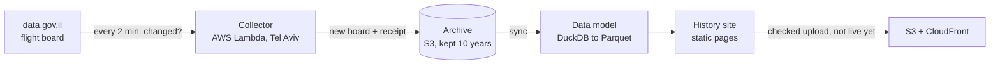

# flights-archive

Keeps the history of the Ben Gurion airport flight board, which overwrites itself every 15 minutes: every version kept for 10 years, with a receipt for every download.

**Live site:** coming soon (hosting is built and waiting on AWS) · **Design notes:** [docs/](docs/README.md) · **Run it yourself:** [docs/operations.md](docs/operations.md)

**Stack:** Python 3.13 · AWS SAM (Lambda, EventBridge Scheduler, S3 Object Lock, CloudWatch, SNS) · DuckDB and Parquet · S3 + CloudFront for the site · GitHub Actions

<!-- screenshot: docs/img/timeline.png, added when the site is live -->

## Why

The Israel Airports Authority publishes the airport's live departures and arrivals board as open data on data.gov.il. The board shows about one to two days back and three days ahead, and every refresh replaces the last one. When a flight goes from ON TIME to CANCELED, the board itself keeps no record of what it said before.

This project keeps that record. It saves every version of the board, writes down what it saved and when, and turns the archive into a timeline for each flight: what the board said, and when we first saw it. That history answers questions the live board can't. The first is how far ahead cancellations appear.

## What it does today

- **Collector**, live on AWS. A Lambda function in Tel Aviv checks every 2 minutes whether the board changed and downloads it when it did, about 4 times an hour. The archive starts on 27 October 2026 and has been continuous since 29 October.
- **Archive.** Every board is stored exactly as received, and every version is kept for 10 years under S3 Object Lock (governance mode); the collector never overwrites a stored file. After every download it also writes a receipt: when it ran, what it got, which code version wrote it. As of 29 October 2026: 39 boards, covering 3,113 flight listings (a flight sold under several numbers counts once per number).
- **Data model.** DuckDB turns the archive into Parquet tables: every change to every flight, retimed flights linked to their new slot where the board allows it, flight numbers that share a slot, times and check-in counters grouped as likely codeshares, and each first CANCELED sighting bracketed between the last board without it and the first board with it.
- **History site.** A static page per day, with a timeline per flight number. Built and tested; it goes live once AWS enables the hosting.

## How it works

## Engineering choices worth a look

- **Nothing stored is ever replaced, and every download leaves a receipt.** The snapshots are the project, so the collector writes each file once, S3 keeps every version, and the model trusts only boards it can account for. [docs/receipts.md](docs/receipts.md)
- **A polite collector that stops cold.** It identifies itself on every request, downloads the full board only when it changed (or every 30 minutes as a safety check), and on any sign of being blocked it stops and waits for a person. The data license excludes data obtained by working around a block. [docs/operations.md](docs/operations.md)
- **Three clocks.** Board times are Israel wall-clock with no offset, our times are UTC, and the October clock change repeats an hour. Each conversion rule is written down and tested, including under an Israeli time zone. [docs/data-model.md](docs/data-model.md)
- **Claims no stronger than the evidence.** The site says "first observed CANCELED on the public board", never "cancelled at", because the board is all we see. A check before every upload refuses a page that uses a banned phrasing, or that lacks the source line. [docs/timeline.md](docs/timeline.md), [docs/terms.md](docs/terms.md)
- **Tests that are themselves tested.** 289 tests, and 156 deliberate bugs that a [script](scripts/mutation_check.py) plants one at a time to prove a test catches each (as of 29 October 2026). Both run in CI on every push.
- **Cheap, boring infrastructure.** About $1 to $2 in the archive's first year ([operations.md](docs/operations.md#cost)) and under $0.05 a month for the site ([publishing.md](docs/publishing.md#cost-monthly)), each estimate written down with its sources.

## What's next

- **First cancellation statistics** once enough continuous data exists: how far ahead cancellations appear on the board, within the 72 hours it shows.
- **Per-flight cancellation forecasts**, only once enough cancellations exist to score them honestly, with a published Brier score against a historical-rate baseline.
- **No delay figures** until it's confirmed whether the board's estimated time is gate or runway time.

## Data and license

Source: Israel Airports Authority flight board, published on [data.gov.il](https://data.gov.il) (dataset `flydata`), used under the [data.gov.il terms of use](https://data.gov.il/he/terms-of-use). The clauses that bear on this project are quoted in [docs/terms.md](docs/terms.md). This is an unofficial project, not affiliated with or endorsed by the Israel Airports Authority, data.gov.il or the State of Israel. The raw archive is not published.

## Operating it

Deploying the collector, the alerts, clearing a block, development and costs: [docs/operations.md](docs/operations.md). If the collector reports `BLOCKED`, see [If it's blocked](docs/operations.md#if-its-blocked).
